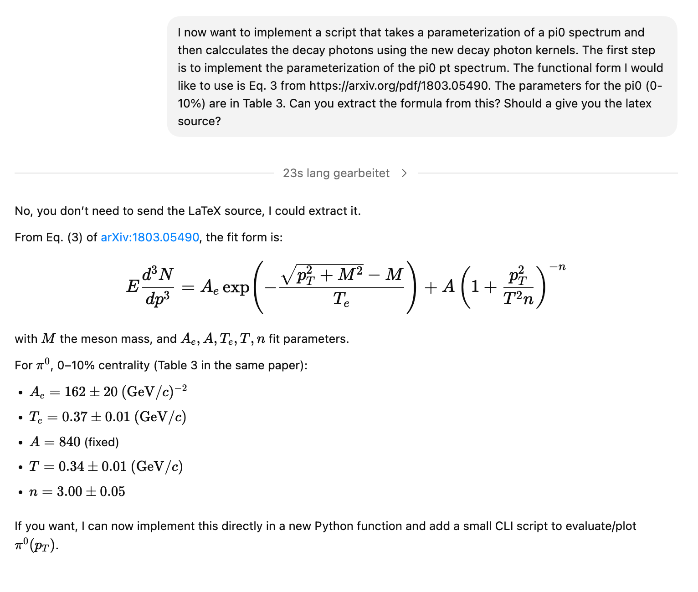

## Motivation

- Need a robust low-$p_T$ $\eta/\pi^0$ input for decay-photon cocktail subtraction.
- Measured $\eta/\pi^0$ points are sparse at low $p_T$ and have large uncertainties.
- Strategy: constrain low-$p_T$ region with measured $K/\pi$ + model double ratio.
- Needed for upcoming ALICE direct-photon papers for 2015 Pb--Pb data and 2018 Pb--Pb data (both at $\sqrt{s_{NN}} = 5.02$ TeV).
- Use 2.76 TeV, 0-10\% data to illustrate the method and systematics (small paper project).

## Workflow

```{=latex}
\begin{center}
\resizebox{0.855\textwidth}{!}{%
\begin{tikzpicture}[
  node distance=9mm and 7mm,
  box/.style={draw, align=center, inner sep=3pt, font=\sffamily\footnotesize},
  arr/.style={-Triangle, line width=0.8pt}
]
\node[box] (data) {Measured spectra\\$\pi^\pm, K^\pm, p+\bar p$};
\node[box, right=of data] (fit) {Blast-wave fit\\($T_{\mathrm{kin}}, \beta_s, n$)};
\node[box, right=of fit] (kernel) {Feeddown kernels\\(PYTHIA decay chains)};
\node[box, below=of fit] (dr) {Model double ratio\\$\left[(\eta/\pi^0)/(K/\pi)\right]_{\mathrm{model}}$};
\node[box, left=of dr] (kpi) {Measured $K/\pi$};
\node[box, right=of dr] (eta) {Pseudo low-$p_T$\\$\eta/\pi^0$ points};
\node[box, below=of dr] (final) {Final $\eta/\pi^0$ fit\\(data + pseudo)};
\node[box, below=of final] (cocktail) {Improved decay-photon cocktail};

\draw[arr] (data) -- (fit);
\draw[arr] (kernel) -- (fit);
\draw[arr] (fit) -- (dr);
\draw[arr] (kpi) -- (dr);
\draw[arr] (dr) -- (eta);
\draw[arr] (eta) -- (final);
\draw[arr] (final) -- (cocktail);
\end{tikzpicture}
}
\end{center}
```

## Simultaneous Blast-Wave + Feeddown Fit

:::: {.columns align="center"}

::: {.column width="50%"}

```{=latex}
\vfill
\vspace*{0.8em}
```

{width=100%}

```{=latex}
\vfill
```

:::

::: {.column width="50%" }

- Inputs: ALICE $\pi^\pm$, $K^\pm$, $p+\bar p$ (2.76 TeV, 0-10\%).
- Model: blast-wave + resonance feeddown kernels.
- Relative primary density:
  ```{=latex}
  \vspace{-0.5em}
  {\scriptsize
  \[
  n_a=\frac{g_a}{2\pi^2}T_{\mathrm{ch}}m_a^2
  \sum_{k=1}^{n}\frac{(\pm1)^{k+1}}{k}\,
  K_2\!\left(\frac{k m_a}{T_{\mathrm{ch}}}\right)
  \]
  \[
  \times \exp\!\left(\frac{k\mu_a}{T_{\mathrm{ch}}}\right)
  \]
  }
  ```
- Feeddown fom particles with proper lifetime $c\tau < 1~\text{mm}$, and mass $m < 2~\text{GeV}/c^2$.
- Fit parameters: $T_{\mathrm{kin}}, \beta_s, n$.

:::

::::

## Core Double-Ratio Construction

:::: {.columns align="center"}

::: {.column width="50%"}

```{=latex}
\vfill
\vspace*{0.8em}
```

{width=100%}

```{=latex}
\vfill
```

:::

::: {.column width="50%"}

- Build $\left(\frac{\eta/\pi^0}{K/\pi}\right)_{\mathrm{model}}$ from fitted spectra.
- Convert to pseudo-data:
  $(\eta/\pi^0)_{\mathrm{pseudo}} =
  \left(\frac{\eta/\pi^0}{K/\pi}\right)_{\mathrm{model}}
  (K/\pi)_{\mathrm{meas}}$.
- Advantage: uses precise measured $K/\pi$ at low $p_T$.

:::

::::

## Flow-Scaling Cross-Check

:::: {.columns align="center"}

::: {.column width="50%"}

```{=latex}
\vfill
\vspace*{0.8em}
```

{width=100%}

```{=latex}
\vfill
```

:::

::: {.column width="50%"}

- We approximate identified-hadron spectra with
  $$
  \frac{dN_a}{dp_T\,dy} = C_a F(m_T^*)
  $$
- Scaling variable:  $m_T^* = \gamma(m_T-\beta p_T)$
- Optimal $\beta$ from $\chi^2$ minimization.
- This gives an independent prediction:
  $$
  \eta/K
  =
  \frac{F\!\left(\gamma\left(\sqrt{m_\eta^2+p_T^2}-\beta p_T\right)\right)}
  {F\!\left(\gamma\left(\sqrt{m_K^2+p_T^2}-\beta p_T\right)\right)}.
  $$
- Purpose: cross-check against the core method.

:::

::::

## Cross-Checks and Systematics

:::: {.columns align="center"}

::: {.column width="50%"}

```{=latex}
\vfill
\vspace*{0.8em}
```

{width=100%}

```{=latex}
\vfill
```

:::

::: {.column width="50%"}

- Compare core result to:
  - no-feeddown refit,
  - flow-scaling alternative,
  - FluiduM cross-check,
  - $T_{\mathrm{chem}}$ variations.
- Use resulting envelope to define low-$p_T$ uncertainty model.
- This envelope is propagated into final $\eta/\pi^0$ presentation.

:::

::::

## Final $\eta/\pi^0$ for 0-10\%

:::: {.columns align="center"}

::: {.column width="50%"}

```{=latex}
\vfill
\vspace*{0.8em}
```

{width=100%}

```{=latex}
\vfill
```

:::

::: {.column width="50%"}

- Combine measured points + pseudo-data constraints.
- Fit with flow-inspired parameterization.
- Surprisingly good agreement with Ren-Drees method

:::

::::

## Decay-Photon Cocktail Impact

:::: {.columns align="center"}

::: {.column width="50%"}

```{=latex}
\vfill
\vspace*{0.8em}
```

{width=100%}

```{=latex}
\vfill
```

:::

::: {.column width="50%"}

- Cocktail decomposition shown for dominant sources.
- $\eta$ uncertainty band is propagated to decay-photon fractions.
- Lower panel compares $\eta$ uncertainty impact to a 5% direct-photon reference scale.

:::

::::

## Feeddown Structure: $\eta$

:::: {.columns align="center"}

::: {.column width="50%"}

```{=latex}
\vfill
\vspace*{0.8em}
```

{width=100%}

```{=latex}
\vfill
```

:::

::: {.column width="50%"}

- Top 10 components shown.
- Primary fraction and summed selected feeddown shown explicitly.
- Most important feeddown from $a_0(980)^+$, $a_0(980)^0$, $a_0(980)^-$, $\eta'$, and $f_1(1285)$.

:::

::::

## Feeddown Structure: $K^+$

:::: {.columns align="center"}

::: {.column width="50%"}

```{=latex}
\vfill
\vspace*{0.8em}
```

{width=100%}

```{=latex}
\vfill
```

:::

::: {.column width="50%"}

- Top 10 components shown.
- Primary fraction and summed selected feeddown shown explicitly.
- Most important feeddown from $K^{*0}$, $K^{*+}$, $\phi$, $K_1(1270)^+$, and $K_1(1270)^0$.

:::

::::

## Note on the Use Coding Agents in the Paper

Acknowledgments:

This work has been supported by the DFG (German Research Foundation) - Project-ID 273811115 - SFB 1225 ISOQUANT.
We wish to acknowledge the support of ...

We used OpenAI Codex to assist with code generation based on human-written prompts. All scientific results, validations, and interpretations were performed by the authors.

## Prompt Demo

:::: {.columns align="center"}

::: {.column width="50%"}

```{=latex}
\vfill
\vspace*{0.8em}
```

{width=100%}

```{=latex}
\vfill
```

:::

::: {.column width="50%"}

- Enormous productivity boost for code generation. Can spent more time on the level if ideas.
- Central task of humans remains to design good prompts and check/control the output.
- For me, coding agent have become a more relevant tool than e.g. Mathematica (for which the University has licenses).
- I think it it would be timely for the University to provide institutional licenses to ensure researchers remain competitive and well-equipped.

:::

::::

## Takeaway

- The method ties low-$p_T$ $\eta/\pi^0$ to measured hadron ratios with explicit feeddown handling.
- Main deliverable for direct-photon analyses: constrained $\eta/\pi^0$ curve + uncertainty band.
- Coding agents like OpenAI Codex can significantly enhance productivity, but human oversight is crucial.
